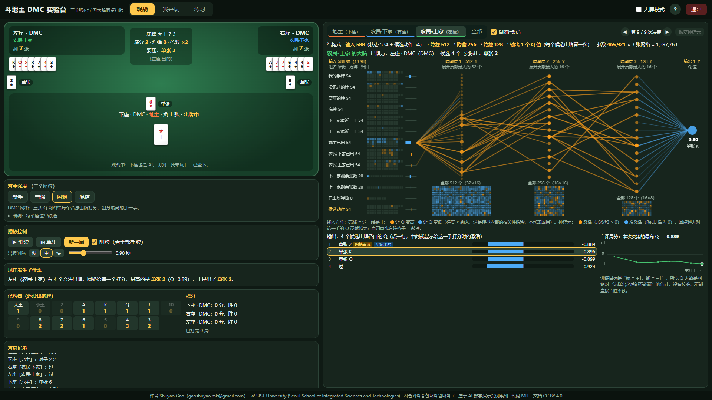
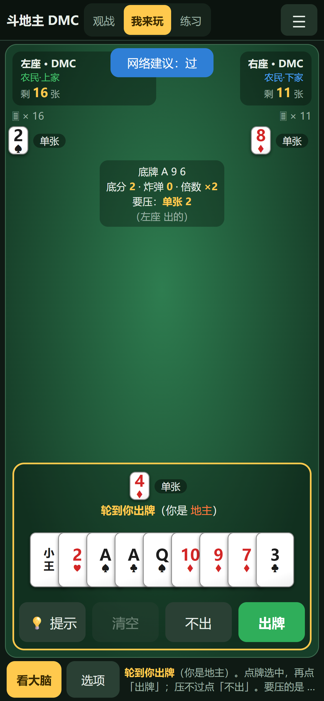

> **AI 教学演示案例 / AI Teaching Demos** 系列

# 斗地主 DMC 实验台（doudizhu-dmc-lab）

**Shuyao Gao**（gaoshuyao.mk@gmail.com）· aSSIST University (Seoul School of Integrated Sciences and Technologies) · 서울과학종합대학원대학교
代码 MIT · 文档与教学素材 CC BY 4.0

**三个强化学习 AI 同桌打斗地主，旁边实时画出它们“大脑”里的真实激活：每一步把所有合法出牌都打一个分，出分最高的那一手。** 打开网页就能看三个 AI 对打、自己坐下和 AI 打一局、或者照着任务清单练习；手机竖屏也能玩。

*Three small Q-networks trained with Deep Monte Carlo self-play play DouDizhu in your browser, with a live "brain panel" showing their real activations. See the English summary at the end.*





## 怎么打开（都不需要安装）

- **手机**：点在线链接 <https://shuyaogao.github.io/doudizhu-dmc-lab/>（竖屏打开，往下滑看大脑；点「我来玩」自己打）。
- **电脑**：点同一个在线链接；或者在 [Releases](https://github.com/ShuyaoGao/doudizhu-dmc-lab/releases) 下载 `doudizhu-dmc-lab-v1.0.zip`，解压后双击 `index.html`；或者点 **Code → Download ZIP**，解压后双击 `play/index.html`。

页面是纯静态网页：不需要 Python，不需要联网，不会在后台留下任何进程。Windows 上的 Edge / Chrome 和手机尺寸都测过；Safari 需要在真实 Mac 上确认（见常见问题）。

## 怎么用

页面顶部切换三种模式：

| 模式 | 做什么 |
|---|---|
| **观战**（默认） | 三个 AI 自动对打，可以暂停、单步、调速度、明牌。大脑面板自动跟随正在出牌的那一家。 |
| **我来玩** | 你坐下座，和两个 AI 打一局：先叫分，再出牌。 |
| **练习** | 带 8 项任务清单的「我来玩」（对手默认“新手”），做完一项自动打勾；附 14 种牌型的图鉴。 |

**电脑（键盘鼠标）**：点牌选中（再点取消），<kbd>回车</kbd> 出牌，<kbd>空格</kbd> 不出，<kbd>T</kbd> 提示，<kbd>Esc</kbd> 清空；<kbd>P</kbd> 暂停 / 继续，<kbd>N</kbd> 单步，<kbd>H</kbd> 或右上角 **?** 打开操作说明。右上角「大屏模式」把左右比例从约 45:55 调到 35:65，方便投影。鼠标停在按钮上会有带动画的小提示。

**手机（触屏，竖屏）**：头部压成一行，右上角 ☰ 里有对手强度、明牌、新一局、操作说明和退出。观战时牌桌在上、大脑面板紧跟在牌桌下面（紧凑画法），往下滑看。点「我来玩」后一屏显示、不用滚动：上方是牌桌，下方是你的手牌——**点牌选中**（再点取消），牌多时**左右滑动**，然后点 **出牌**、**不出** 或 **提示**（按钮都够大）；「看大脑」全屏打开大脑面板，「返回」关闭。横屏时会提示竖屏体验更好。

- **对手强度**有 4 个预设：新手（随机出牌）/ 普通（贪心规则）/ 困难（DMC 网络）/ 混搭；“细调”里可以逐个座位单独选。
- **大脑面板**：顶部切换「地主 / 农民·下家 / 农民·上家 / 全部」。
  - 点输出列表里的一行，中间显示网络给这一手打分时的激活；
  - 在网络图上点神经元可以把它“敲掉”（置零），看网络会不会改主意，「恢复神经元」一键复原；
  - ◀ ▶ 翻看这一家本局的每一次决策。
- **公平性**：「我来玩」时对手的大脑在本局结束前锁住，因为网络输入里有那一家自己的手牌，候选列表也会暴露它手里有什么。打完自动解锁，或者打开「明牌（作弊）」。
- **提示为什么公平**：💡 提示用的是“你这个身份”的那张网络，它只看得到你能看到的信息（自己的手牌、桌面上出过的牌、底牌、剩余张数），看不到对手的牌。

## 课堂上怎么用（推荐顺序）

1. **观战，先不讲网络**（3 分钟）：让大家看 AI 打一局，认识叫分、地主、农民、牌型。
2. **暂停 + 单步**：在某一手停下，看输出列表：这一步一共有多少个合法出牌、每个的 Q 是多少、为什么选了最高的那个。重点讲 **“动作进输入、网络只输出一个分数”**。斗地主的出牌组合有上万种（DouZero 项目说明里写的是 10^4 量级），没法给每种出牌各配一个输出。
3. **看输入**：15×4 的牌面方阵是怎么把“手里有几张 7”变成 0/1 的；橙色、蓝色的归因表示哪些牌让 Q 变高、哪些让 Q 变低。
4. **敲掉神经元**：随手敲掉几个贡献最大的神经元，看决策是否改变，讨论“分布式表示”。
5. **切到「全部」**：三张网络各管一个身份；看三条“自评局势”曲线，地主和农民的走势常常一个往上、一个往下。
6. **我来玩 / 练习**：学生自己打一局（手机上也行），用 💡 提示对比自己和网络的想法。

## 它是怎么做的

```
局面（534 维）──┐
                ├─► [588 维] ─► 隐藏 512 ─► 隐藏 256 ─► 隐藏 128 ─► Q(局面, 这一手)
候选出牌（54 维）┘                         （ReLU MLP）
对每一个合法出牌各算一次，取 Q 最大的出；地主 / 农民·下家 / 农民·上家各一张网络
```

- **算法**：深度蒙特卡洛（Deep Monte Carlo, DMC），是 DouZero（Zha et al., 2021）的单机精简版。三个身份各一张 Q 网络，ε-greedy 自博弈打完整局；终局奖励（地主胜：地主 +1、农民 −1，反之取反）直接作为这局每一步的回归目标，用 MSE 训练。
- **网络**：每张网络 465,921 个参数，三张共 1,397,763 个（`checkpoints/dmc_latest.pt`）。
- **输入 534 + 54 维**：我的手牌、其余两家手牌并集（没见过的牌）、要压的牌、底牌、上下家最近一手、三家已出的牌（每组 54 维）+ 上下家剩余张数（各 20 维 one-hot）+ 已出炸弹数（8 维）+ 候选动作（54 维）。全部来自合法信息，不偷看他人手牌。
- **浏览器里的网络**：权重转成 float16（`play/js/model_dmc.js`，3.7 MB），在浏览器里用纯 JavaScript 前向计算。大脑面板显示的是**真实的激活**，不是示意图。
- **规则引擎**：`play/js/engine.js` 逐条移植自 Python 版 `doudizhu/`（15 种牌型、叫分、春天 / 炸弹计分）。

### 模型是怎么来的

**这些模型是事先训练好再导出的**：`checkpoints/dmc_latest.pt` 用本仓库的 `train.py` 在 CPU 上训练，**训练步数和用时没有记录下来**（所以这里不写）。想自己重新训练，见下文“想自己训练或修改”。

### 成绩（`results/result.json`，固定种子，可复现）

叫分制定地主，每组 200 局，种子 2026：

| 地主 | 农民 | 地主胜率 | 地主平均得分 |
|---|---|---:|---:|
| 随机 | 随机 | 35.5% | -2.06 |
| 贪心 | 随机 | 92.0% | +5.66 |
| 随机 | 贪心 | 5.5% | -6.13 |
| 贪心 | 贪心 | 57.0% | +0.99 |
| DMC | 随机 | 97.5% | +5.68 |
| 随机 | DMC | 5.5% | -6.40 |
| DMC | 贪心 | 68.5% | +2.80 |
| 贪心 | DMC | 52.0% | -0.13 |
| DMC | DMC | 70.5% | +3.23 |

三个 DMC 网络同桌互打 500 局（种子 777）：

| 指标 | 数值 |
|---|---:|
| 地主胜率 | 71.4% |
| 叫分分布（1 / 2 / 3 分） | 2 / 270 / 228 局 |
| 平均每局炸弹 / 王炸 | 0.298 个 |
| 春天 / 反春天 | 5 局 |
| 平均倍数 | ×1.354 |
| 地主平均得分 | +2.90 |
| 平均每局手数（含过牌） | 37.49 |

- DMC 当地主对贪心农民，地主胜率 68.5%；贪心地主对贪心农民是 57.0%。
- DMC 当农民时，把贪心地主的胜率压到 52.0%。
- 叫分制下叫得高的人当地主，地主往往是手牌最强的一家，再加上 3 张底牌，所以即使棋力相同，地主胜率也天然高于 50%。
- 这是一个小网络，**不是**斗地主高手。课上请把它当作“看得懂的强化学习”，不要当作“最强 AI”。

### 浏览器端和 PyTorch 是同一个网络

- `tests/js/test_parity.js`：用 PyTorch 导出的 420 个决策局面（5,073 个 Q 值）逐个比对：
  - 与同一份 float16 权重的 PyTorch 结果，误差要求 < 1e-5；
  - 与原始 float32 权重相比，误差要求 < 5e-4；
  - 最优动作必须一致。
- `tests/js/test_engine.js`：JS 规则引擎与 Python 引擎逐项比对，覆盖合法动作列表（含顺序）、牌型解析、叫分、完整对局的每一步状态编码和结算。
- `tests/test_feature_names.py`：锁住大脑面板上每个输入特征的名字，保证和 `doudizhu/env.py` 的实际编码逐维对应。
- `tests/test_browser.py`、`tests/test_mobile.py`：用本机 Edge 在 1920×1080、1366×768 和四个手机 / 平板尺寸（触屏模拟）上跑一遍关键操作：观战单步、大脑视图、敲神经元、我来玩一整局、手机上点牌出牌、看大脑 / 返回，断言没有 JS 报错、没有横向溢出、操作模式整页不滚动。

## 想自己训练或修改

需要 Python 3.10+：

```bash
pip install -r requirements.txt          # numpy、torch（CPU 版即可）、pytest
python train.py --episodes 50000 --max-minutes 10   # 重新训练，覆盖 checkpoints/dmc_latest.pt
python -m tools.run_eval                 # 固定种子重跑评估 → results/result.json
python -m tools.build --release          # 重新导出 play/js/model_dmc.js，并打包 release/*.zip
python -m tools.export_fixtures          # 改了规则或模型后，重新生成测试夹具
python -m tools.screenshots              # 重新截 README 的图（电脑 + 手机）
python -m pytest                         # 全部测试（JS 测试需要 Node.js；浏览器测试需要本机 Edge；手机尺寸测试另需 pip install playwright）
python play.py                           # 命令行版人机对战
```

`train.py` 的参数：`--episodes` 最多打多少局，`--max-minutes` 最长训练多少分钟（先到者为准）。还有 `--lr`、`--eps-start`、`--eps-end`、`--mix-prob` 等，见文件开头。

## 目录结构

```
index.html             根目录跳转页（GitHub Pages 和 Release zip 的入口，自动跳到 play/）
play/                  双击即玩的静态网页（index.html、css/、js/）
  css/app.css          电脑端样式        css/mobile.css   手机竖屏样式（牌类通用，可整份复用）
  js/engine.js         规则引擎（移植自 doudizhu/）
  js/nn.js             浏览器端前向 + 随机 / 贪心 / DMC 三种智能体
  js/brain.js          大脑面板（窄栏用紧凑画法）
  js/mobile.js         手机竖屏工具：设备判断、☰ 菜单、全屏面板、横屏提示、牌列点选、防误触（牌类通用）
  js/app.js            页面逻辑（模式、出牌流程、练习、说明、退出）
  js/model_dmc.js      导出的 float16 权重（tools/export_model.py 生成）
doudizhu/              Python 规则引擎：牌、15 种牌型、对局流程、状态编码
rl/                    Q 网络与智能体
train.py               DMC 自博弈训练
evaluate.py            组合对战评估        stats_rl_vs_rl.py  DMC 互打统计
play.py                命令行版人机对战
checkpoints/           训练好的模型 dmc_latest.pt
results/               result.json（评估结果）、eval_log.txt
tools/                 构建、导出、评估、浏览器自检（edge.py）、手机尺寸验收（mobile_check.py）、截图、署名填充
tests/                 Python 测试、tests/js（Node 差分测试）、tests/fixtures（PyTorch 导出的标准答案）
docs/img/              截图
```

## 常见问题

- **关掉页面后还在后台跑吗？** 不会。页面是纯静态网页，关掉标签页就全部结束，不留后台进程。「退出」（电脑右上角；手机在 ☰ 里）会先停掉所有计时器和计算，再尝试关闭标签页；浏览器不允许关闭时，会显示“已停止运行”。
- **手机上怎么玩？** 竖屏打开在线链接。观战时往下滑看大脑；点「我来玩」后点牌选中、左右滑动看更多牌，再点「出牌」「不出」「提示」；「看大脑」全屏看网络，「返回」关闭。
- **双击 index.html 却用记事本打开了？** 右键 →「打开方式」→ 选浏览器。
- **Mac 上能用吗？** 页面只用标准 HTML / JavaScript，Safari 应该可以打开，但作者还没在真实 Mac 上测过，遇到问题欢迎反馈。Firefox 也没有测过。

## 许可证与引用

代码 MIT（[LICENSE](LICENSE)），文档 CC BY 4.0（[LICENSE-docs](LICENSE-docs)），使用请注明出处。
引用信息见 [CITATION.cff](CITATION.cff)（GitHub 右侧 “Cite this repository”）。第三方组件与来源见 [THIRD_PARTY.md](THIRD_PARTY.md)。

## AI 辅助开发声明

代码由 Claude Code 辅助编写，经作者审阅。

## English summary

**doudizhu-dmc-lab** is a browser-only teaching demo (AI Teaching Demos) of deep reinforcement learning on DouDizhu (Fight the Landlord), a three-player Chinese card game. Three small Q-networks (588 → 512 → 256 → 128 → 1, one per role) are trained with Deep Monte Carlo self-play in the spirit of DouZero: the candidate move is part of the input, so the network scores every legal move and plays the best one. The page runs fully offline (double-click `index.html`) and works on phones in portrait mode (tap cards, scroll the hand, big play / pass / hint buttons, full-screen brain panel). A live "brain panel" shows the real activations, gradient × input attributions and Q values computed in JavaScript from the exported float16 weights, and lets students knock out neurons. You can watch, play against the agents, or follow a guided practice checklist. Training, evaluation and test code (PyTorch, Node.js parity tests against PyTorch, headless-browser checks on desktop and emulated mobile sizes) are included. Code: MIT; docs: CC BY 4.0. Author: Shuyao Gao (gaoshuyao.mk@gmail.com), aSSIST University (Seoul School of Integrated Sciences and Technologies).
